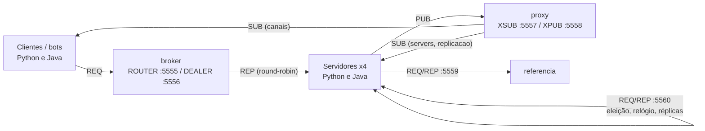

# CC7261 – Sistema de troca de mensagens instantâneas (estilo BBS/IRC)

Projeto da disciplina **CC7261 – Sistemas Distribuídos**: um protótipo de serviço de mensagens com canais públicos, em que *bots* (clientes) fazem login, criam canais, publicam e recebem publicações, e em que os servidores guardam tudo em disco, sincronizam relógios, elegem um coordenador e replicam os dados entre si.

**Integrantes:** 

Orlando Nagrockis Bertholdo RA: 24.223.003-5
Lorenzo Colonnese Chiganças RA: 24.223.085-2

---

## Sumário
1. [Visão geral e arquitetura](#1-visão-geral-e-arquitetura)
2. [Linguagens e bibliotecas](#2-linguagens-e-bibliotecas)
3. [Como executar](#3-como-executar)
4. [Serialização das mensagens](#4-serialização-das-mensagens)
5. [Persistência](#5-persistência)
6. [Troca de mensagens](#6-troca-de-mensagens)
7. [Comportamento dos bots](#7-comportamento-dos-bots)
8. [Relógios, heartbeat e eleição](#8-relógios-heartbeat-e-eleição)
9. [Replicação e consistência (Parte 5)](#9-replicação-e-consistência-parte-5)
10. [Como acompanhar os logs](#10-como-acompanhar-os-logs)
11. [Limitações conhecidas](#11-limitações-conhecidas)

---

## 1. Visão geral e arquitetura

Tudo roda em containers, orquestrados pelo Docker Compose, e se comunica pela rede criada por ele usando **ZeroMQ**. Não há interação com usuário: os usuários são bots que sobem junto com o `docker compose up`.

São 11 containers:

| Serviço | Qtde | Função |
|---|---|---|
| `broker` | 1 | Balanceia os pedidos dos clientes entre os servidores (round-robin) |
| `proxy` | 1 | Proxy Pub/Sub, por onde passam as publicações dos canais e os avisos entre servidores |
| `referencia` | 1 | Serviço de referência: rank dos servidores, lista de servidores e heartbeat |
| `servidor-python-1`, `-2` | 2 | Servidores em Python |
| `servidor-java-1`, `-2` | 2 | Servidores em Java |
| `cliente-python-1`, `-2` | 2 | Bots em Python |
| `cliente-java-1`, `-2` | 2 | Bots em Java |



Estrutura do repositório:

```
.
├── docker-compose.yml
├── mensagem.proto          # definição de todas as mensagens (Protocol Buffers)
├── python/                 # broker, proxy, referência, servidor e cliente em Python + Dockerfile
├── java/                   # servidor e cliente em Java + Dockerfile
└── dados/                  # bancos SQLite (criados na execução, um por servidor)
```

## 2. Linguagens e bibliotecas

Foram usadas **duas linguagens** (projeto em dupla), cada integrante implementou o cliente **e** o servidor na sua linguagem. Os servidores e os clientes das duas linguagens trocam mensagens entre si.

| | Python | Java |
|---|---|---|
| Versão | 3.13 | 21 (Temurin) |
| ZeroMQ | `pyzmq` | `jeromq` 0.5.4 |
| Serialização | `protobuf` (via `grpcio-tools`) | `protobuf-java` 3.21.12 |
| Banco | `sqlite3` (biblioteca padrão) | `sqlite-jdbc` 3.46 |

Broker, proxy e serviço de referência foram feitos em Python.

## 3. Como executar

Pré-requisito: Docker com Docker Compose.

```bash
docker compose up --build -d     # sobe os 11 containers em segundo plano
docker compose ps                # confere se todos estão de pé
docker compose logs -f           # acompanha tudo
docker compose down              # para e remove os containers
sudo rm -rf dados                # (opcional) apaga os bancos, para recomeçar do zero
```

Cada servidor e cada cliente recebe o seu nome pela variável de ambiente `NOME` definida no `docker-compose.yml` (por exemplo `servidor-java-2`, `bot-python-1`). É esse nome que identifica o servidor no serviço de referência, nas eleições e na replicação, e que nomeia o seu arquivo de banco.

## 4. Serialização das mensagens

Todas as mensagens são serializadas em binário com **Protocol Buffers** (nunca JSON, XML ou texto). O arquivo `mensagem.proto` é compartilhado: o Dockerfile de cada linguagem gera o código a partir dele, então Python e Java usam exatamente o mesmo formato.

Escolhemos Protobuf porque tem biblioteca oficial nas duas linguagens, formato compacto e tipos fortes, com `oneof` para representar "uma requisição entre várias".

- **Cliente ↔ servidor:** `Request` (com `oneof` de `ReqLogin`, `ReqCriarCanal`, `ReqListarCanais`, `ReqPublicar`) e `Reply` (com `oneof` de `RepLogin`, `RepCriarCanal`, `RepListarCanais`, `RepPublicar`).
- **Publicação nos canais:** `EnviarPub` (tópico, texto, timestamp e relógio lógico).
- **Servidor ↔ referência:** `ReqReferencia` / `RepReferencia`.
- **Servidor ↔ servidor:** `ReqServidor` / `RepServidor` (eleição, relógio, réplicas) e `AnuncioCoordenador`.
- **Replicação:** `ReplicaPub` e `ReplicaCanal`.

**Timestamp:** as mensagens de cliente e de publicação levam o timestamp do envio (`google.protobuf.Timestamp`). **Relógio lógico:** todas as mensagens trocadas levam o campo `relogio` com o contador de quem envia (seção 8).

## 5. Persistência

Cada servidor guarda os seus dados em **SQLite**, em um arquivo próprio (`dados/<tipo>-<n>/<nome-do-servidor>.db`). Os arquivos **não são compartilhados** entre servidores.

Escolhemos SQLite porque é um banco em arquivo, sem servidor extra, com suporte nas duas linguagens, e porque a restrição `UNIQUE` ajuda a deixar a replicação idempotente (seção 9).

| Tabela | Colunas | Conteúdo |
|---|---|---|
| `logins` | `usuario`, `timestamp_login` | Todos os logins recebidos por aquele servidor |
| `canais` | `nome` (único), `timestamp_criacao` | Canais criados (replicados em todos os servidores) |
| `publicacoes` | `id_uuid` (único), `topico`, `mensagem`, `timestamp_pub`, `servidor_origem`, `relogio_logico` | Todas as publicações (replicadas em todos os servidores) |

Os dados persistem entre execuções enquanto a pasta `dados/` for mantida.

## 6. Troca de mensagens

| Padrão | Quem fala com quem | Detalhe |
|---|---|---|
| **REQ/REP via broker** | cliente → broker → servidor | Login, criar canal, listar canais, publicar. O broker usa `ROUTER` (porta 5555, clientes) e `DEALER` (porta 5556, servidores), que distribui em round-robin |
| **PUB/SUB via proxy** | servidor → proxy → clientes/servidores | Proxy com `XSUB` (5557, quem publica) e `XPUB` (5558, quem assina). O **tópico é o nome do canal** |
| **REQ/REP direto** | servidor → referência (porta 5559) | Registro, lista de servidores, heartbeat |
| **REQ/REP direto** | servidor → servidor (porta 5560) | Eleição, verificação do coordenador, sincronização de relógio e pedido de réplicas |

Fluxo de uma publicação: o bot envia `ReqPublicar` ao servidor (via broker); o servidor grava a publicação no banco, publica no tópico do canal pelo proxy, publica a réplica para os outros servidores e responde `RepPublicar` ao bot.

Tópicos especiais no Pub/Sub: `servers` (anúncio do coordenador), `replicacao` (publicações replicadas) e `replicacao_canais` (canais replicados).

Tanto clientes quanto servidores imprimem na tela o conteúdo completo de cada mensagem que enviam ou recebem.

## 7. Comportamento dos bots

Ao subir, cada bot:
1. faz login com o seu nome (`bot-python-1`, `bot-java-2`, ...);
2. lista os canais; se houver menos de 5, cria um canal novo;
3. se estiver inscrito em menos de 3 canais, se inscreve em mais um (escolhido aleatoriamente);
4. entra em loop infinito: escolhe um canal e envia 10 mensagens aleatórias, 1 por segundo.

Toda publicação recebida nos canais assinados é exibida com o canal, o texto, o timestamp de envio e o de recebimento.

## 8. Relógios, heartbeat e eleição

**Relógio lógico (Lamport).** Cada cliente e cada servidor tem um contador. Ele é incrementado antes de cada envio e vai na mensagem. Ao receber, o processo adota `max(contador local, contador recebido)` e soma 1.

**Serviço de referência.** Os servidores se registram pelo nome e recebem um **rank** (ordem de chegada, sem repetir nomes). O serviço também devolve a lista de servidores ativos.

**Heartbeat.** A cada 10 mensagens de clientes recebidas, o servidor avisa a referência que está vivo. O servidor que fica mais de 60 s sem heartbeat é removido da lista. Se um servidor é removido e volta, ele percebe que não está registrado e se registra de novo.

**Eleição (algoritmo do valentão / Bully).** Se o coordenador não responde, o servidor pede a lista à referência e envia `ELEICAO` aos servidores de rank maior. Se algum responde OK, ele espera o anúncio do novo coordenador. Se ninguém responde, ele se elege e publica o nome no tópico `servers`. Todos guardam o coordenador numa variável. A cada 5 s, cada servidor verifica se o coordenador está ativo.

**Sincronização do relógio físico (Berkeley, simplificado).** A cada 15 mensagens trocadas, o servidor pede a hora ao coordenador, enviando a sua. O coordenador calcula a média entre o seu relógio e o do servidor, ajusta o próprio e devolve o ajuste, que o servidor aplica. A referência **não** devolve mais a hora no heartbeat. Diferença em relação ao Berkeley clássico: o coordenador faz a média com **um servidor por vez** (o que pediu), e não coleta o relógio de todos de uma vez.

## 9. Replicação e consistência (Parte 5)

### O problema
O broker distribui os pedidos em round-robin, então cada servidor guarda só uma parte das publicações. Se um servidor cair, perde-se parte do histórico, e quem consultar um servidor vê só uma parte. Precisamos que **todos os servidores tenham todos os dados** (publicações e canais).

### Método escolhido
**Consistência eventual com réplica passiva (cópia dos dados entre as réplicas)**, usando **push + pull**, conforme as categorias vistas em aula:

- **Réplica passiva:** o que é propagado são os **dados** (a linha gravada), e não a operação de atualização. Quem recebe só insere no seu banco.
- **Push (iniciado pelo servidor):** assim que um servidor grava uma publicação (ou cria um canal), ele publica a réplica nos tópicos `replicacao` / `replicacao_canais` do proxy. Todos os outros servidores assinam esses tópicos e inserem no seu banco. Isso mantém os servidores quase sincronizados em tempo real.
- **Pull (iniciado por quem precisa):** a cada 10 s, cada servidor pede à referência a lista de servidores e, para **cada um dos outros**, envia `SOLICITAR_REPLICAS` pela porta 5560. O outro responde com as suas publicações e canais, em **páginas de 100 registros**, com o campo `mais` indicando que ainda há páginas.

### Por que os dois juntos
O Pub/Sub do ZeroMQ não garante entrega: uma mensagem publicada enquanto o assinante ainda está conectando (*slow joiner*), ou enquanto ele está fora do ar, é perdida. O **push** dá baixa latência, e o **pull** periódico corrige o que o push perdeu. Também é o pull que faz um servidor que acabou de subir, ou que voltou depois de uma queda, **recuperar todo o histórico**.

### Como o conflito é evitado (consistência eventual)
- Cada publicação recebe um **UUID** no servidor que a recebeu, junto com o `servidor_origem` e o relógio lógico. A coluna `id_uuid` é `UNIQUE` e a inserção da réplica é `INSERT OR IGNORE`: receber a mesma publicação várias vezes (por push e por pull) é inofensivo.
- As publicações **nunca são alteradas** depois de gravadas, então não há conflito de escrita sobre o mesmo dado. Duas publicações feitas ao mesmo tempo em servidores diferentes são apenas dois registros diferentes.
- Canais têm `nome` `UNIQUE`: se o mesmo canal chegar duas vezes, a segunda inserção é ignorada.
- Resultado: quando os bots param de publicar e as réplicas e os pulls terminam, todos os servidores ficam com os mesmos dados. É a definição de consistência eventual: sem novas escritas, todas as atualizações acabam propagadas para todas as réplicas.

### Mudanças em relação ao método de aula
- Em vez de escolher só push ou só pull, usamos os dois, por causa da perda de mensagens do Pub/Sub.
- Não há líder de escrita: qualquer servidor aceita escrita (o broker escolhe), e a convergência vem de dados imutáveis e idempotentes, não de ordenação global das operações. Isso evita a sincronização global, que o slide cita como custosa.
- O pull é paginado, para não mandar o banco inteiro numa única mensagem.
- Os servidores se descobrem pela lista do serviço de referência, então um servidor novo entra na replicação sem mudar nenhum código.

### Garantias e o que não é garantido
- **Garantido:** convergência eventual de publicações e canais; recuperação do histórico após queda; replicação idempotente.
- **Não garantido:** leitura imediata. Logo depois de uma escrita, a listagem de canais em outro servidor pode ainda não mostrá-la (janela de até ~10 s). Também não há garantia de ordem global entre servidores; a ordem causal pode ser reconstruída pelo `relogio_logico` guardado em cada publicação.
- Os **logins** não são replicados: a Parte 1 pede que cada servidor guarde os logins que recebeu.

## 10. Como acompanhar os logs

```bash
docker compose logs -f servidor-python-1                          # um serviço, ao vivo
docker compose logs --no-log-prefix cliente-python-1 | grep -A 6 "Publicação recebida"   # publicações recebidas por um bot
docker compose logs referencia | grep -E "registrado|Heartbeat|inativo"                    # referência
docker compose logs servidor-java-1 | grep -i -E "coordenador|eleição"                     # eleição
docker compose logs -f servidor-java-2 | grep "recuperadas de"                             # replicação (pull)
```

Para testar a eleição, derrube o coordenador com `docker compose stop <servidor>` e veja os outros elegerem um novo. Para testar a replicação, compare a contagem de linhas da tabela `publicacoes` nos bancos dos servidores.

## 11. Limitações conhecidas

- Os servidores levam alguns segundos para convergir (push imediato, pull a cada 10 s).
- Dois bots que criem o mesmo canal ao mesmo tempo em servidores diferentes podem deixar `timestamp_criacao` diferente entre as réplicas; o nome fica único.
- Um servidor que perca o anúncio de coordenador só corrige quando o coordenador atual cair.
- A remoção de um servidor da lista da referência leva até 60 s.
- O Berkeley é simplificado (seção 8).
- Em caso de erro no login, o bot não repete a tentativa.
